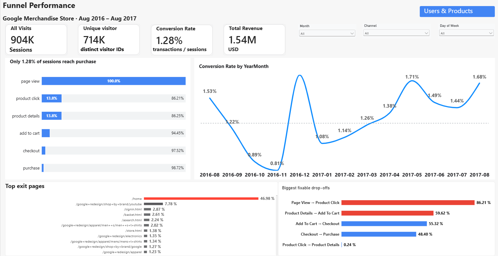
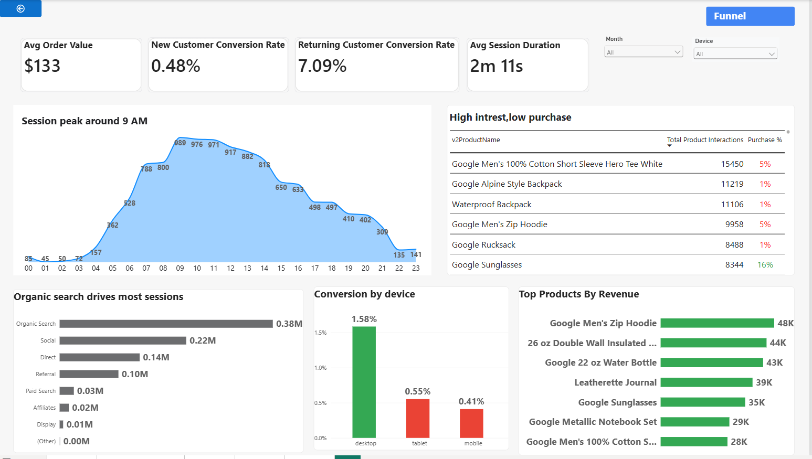

# GA360 Funnel Analysis | Google Merchandise Store

An end-to-end web analytics project using the Google Analytics Sample Dataset in BigQuery, Python/Jupyter Notebook, and Power BI. The project explores sessions, users, product interactions, traffic channels, conversion behaviour, and revenue across **August 2016–August 2017**.

> **Portfolio note:** The dashboard screenshots below are included in the `dashboard/` folder. The `.pbix` file and raw data exports are intentionally excluded from Git because they are large and may contain data that should not be redistributed.

## Dashboard Preview

### 1. Funnel Performance

This page presents overall sessions, unique visitors, conversion rate and revenue, along with the purchase funnel, monthly conversion trend, top exit pages and largest funnel drop-offs.

### 2. Users & Products

This page explores average order value, new versus returning customer conversion, session duration, hourly session activity, traffic channels, device conversion and product performance.

## Project Objectives

- Measure the journey from page views and product interactions through checkout and purchase.
- Understand how conversion performance changes over time.
- Compare new and returning customer conversion behaviour.
- Explore traffic acquisition channels and device-level conversion.
- Identify products that attract interactions but have relatively low purchase rates.
- Translate analysis into practical e-commerce recommendations.

## Dataset

The analysis uses the **Google Analytics Sample Dataset** made available in BigQuery:

`bigquery-public-data.google_analytics_sample`

The dataset represents Google Merchandise Store web analytics data. The project uses session-level and nested hit/product information from the sample dataset. Refer to the notebook for the exact tables, fields, date filters and transformations used.

## Technology Stack

| Tool / Technology | Purpose |
|---|---|
| Google BigQuery | Querying the public Google Analytics sample dataset |
| SQL | Extracting and aggregating sessions, hits and product interactions |
| Python | Data processing and analysis |
| Jupyter Notebook | Reproducible analysis and documentation |
| Pandas / NumPy | Data manipulation |
| Matplotlib / Seaborn | Exploratory visualisation |
| Power BI | Interactive dashboard and business reporting |

## Workflow

1. **Data extraction:** Query the public GA sample dataset in BigQuery using SQL.
2. **Data preparation:** Select relevant session, hit and product fields; flatten nested records where needed; prepare analysis-ready tables.
3. **Analysis:** Explore traffic sources, user behaviour, product interactions, funnel progression and revenue.
4. **Visualisation:** Build exploratory charts in Python and interactive report pages in Power BI.
5. **Recommendations:** Use observed funnel drop-offs and customer/product patterns to identify areas for investigation and optimisation.

The detailed SQL and Python work is maintained together in `GA360_Funnel_Analysis.ipynb`.

## Dashboard Highlights

The current dashboard reports the following headline values for the selected report period and filter state shown in the screenshots:

| Metric | Dashboard value |
|---|---:|
| Sessions | 904K |
| Unique visitors | 714K |
| Conversion rate | 1.28% |
| Total revenue | $1.54M |
| Average order value | $133 |
| New customer conversion rate | 0.48% |
| Returning customer conversion rate | 7.09% |
| Average session duration | 2m 11s |

**Important:** These are the values displayed in the supplied dashboard screenshots. Slicers, date ranges, metric definitions and report filters can change the results. Use the Power BI report and notebook as the source of truth for exact calculations.

## Initial Business Observations

- The overall purchase conversion rate shown on the overview page is 1.28%, indicating that only a small share of sessions reach purchase.
- The funnel visual shows substantial loss between page view and product click, making product discovery and engagement a useful area to investigate.
- The dashboard shows returning-customer conversion (7.09%) higher than new-customer conversion (0.48%). This suggests an opportunity to study onboarding, trust signals and first-purchase incentives for new visitors.
- Organic Search is the largest session source in the displayed channel chart.
- The “high interest, low purchase” table highlights products with many interactions but comparatively low purchase percentages. These products may warrant further investigation of product pages, pricing, availability and checkout paths.

These are descriptive observations, not proof of causation. Validate them against the notebook's calculations and relevant segments before making business decisions.

###  BigQuery access

The source dataset is public, but running queries through the BigQuery API requires a Google Cloud project and authentication. Configure Google Cloud authentication using an approved method, such as Application Default Credentials, and ensure the BigQuery API is enabled for your project.

**Never commit service-account JSON files, API keys, access tokens, `.env` files or private project configuration.** The repository `.gitignore` should exclude credential files. Do not paste credentials into notebook cells or outputs.

## Author

MANIKULAM KARTHIK 
B.Tech –  ARTIFICIAL INTELLIEGENCE AND DATA SCIENCE  
GitHub:  https://github.com/karthik-manikulam  
LinkedIn:  www.linkedin.com/in/
karthik-manikulam-608995320
